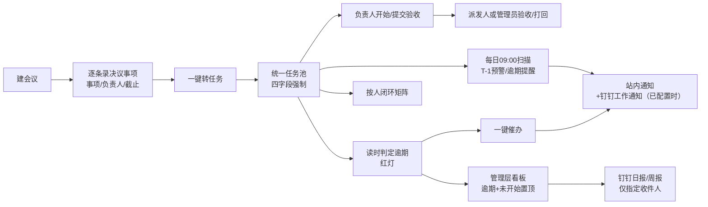

<!-- meta: summary="会议任务督办系统（Spring Boot + Vue + MySQL）：三类来源统一入池、四字段强制、逾期读时红灯+每日去重提醒（钉钉未配置时降级为站内）、按人闭环矩阵与管理层焦点看板、钉钉免登与指定领导日报。" -->
基线依赖：无

# 会议任务督办系统 PRD

## 1. 背景与目标

团队目前的行动项散落在会议纪要、聊天和私人待办里：会开完了，谁负责、什么时候交、做完没有，没有人能在一处说清。结果不是"工具不够"，而是三件事没闭环：**任务没有统一字段**（无法按人/按状态统计）、**到期没有人被提醒**（靠人记）、**管理层看不到风险点**（信息在各自手里）。

本需求交付一个内网网页应用（多人协作、需登录、钉钉免登），用六步把上面三件事串成一条链：

1. 定义三类行动来源：会议决议、项目任务、日常待办；
2. 建统一任务池，每条任务强制四项：**负责人、截止时间、来源、当前状态**；
3. 按人聚合出闭环矩阵（待开始/进行中/待验收/逾期/已完成）；
4. 自动触发：到期未交付亮红灯，支持一键催办与验收确认；
5. 会议结论结构化录入（逐条填写决议事项），开完会一键转任务派到人；
6. 管理层看板只保留全局视图，逾期与未开始自动顶到督办焦点。

**本轮的胜负手是"字段标准"和"自动提醒"两条线**：字段不统一，后面的矩阵与看板全是错数；提醒不可靠，红灯就只是个颜色。提醒必须**推到钉钉**，成员不必每天登录系统也能被触达；第 5 步的"会议结论自动拆解"本轮用**结构化表单**实现（人工逐条填），文本 AI 解析留到后续迭代。

**钉钉当前尚未就绪**：企业应用凭证与 HTTPS 域名需在上线前由 IT 补齐。系统按标准方案实现免登与推送，但必须能在"未配置"状态下完整运行——钉钉入口隐藏、推送跳过并留痕，登录走密码兜底，任务业务一律不受影响（见 AC-21）。这样开发与验收不必等凭证，凭证到位后只需补配置即可开通。

### 1.1 成功判据（上线 4 周内可观察）

- 新会议结束后，80% 的决议事项在会议当天完成录入并转为任务（抽样 20 场会）。
- 任意时刻打开看板，"逾期任务数"与逐条任务人工核对一致（误差 0）。
- 钉钉配置就绪后，逾期任务的钉钉工作通知在到期次日 09:00 前送达负责人，送达率 ≥95%（以钉钉接口返回成功计）。
- 日报收件人名单中的每位领导，每个工作日在钉钉收到督办日报，且日报中的逾期数与看板一致。

## 2. 用户与角色

| 角色 | 谁 | 核心诉求 |
| --- | --- | --- |
| 管理员 admin | 项目 PM / 总助 / 会议组织者 | 建会议、录决议、派任务、催办、验收、维护系统设置 |
| 任务负责人 owner | 被派活的成员 | 只看自己的任务，知道今天该交什么 |
| 管理层 exec | 部门负责人 / 老板（含"督办日报收件人"） | 一眼看到全局风险，顺手调整责任人与期限 |

- 登录以**钉钉扫码 / 钉钉内免登**为主通道（见 AC-18），保留本地账号密码作为管理员兜底与未绑定钉钉人员的应急通道；不开放自助注册。
- 角色由管理员在系统内**手工分配**（钉钉仅提供身份，不提供角色，不按部门/职位自动映射）；新用户首次登录默认为"任务负责人"。
- 督办日报/周报不发给"全体管理层"，而是发给管理员在系统设置中维护的**督办日报收件人名单**（建议 1–5 人，见 AC-20）。

## 3. 用户故事与验收标准

> 验收标准在本需求夹内从 AC-1 连续编号；AC 即本需求的验收契约，技术阶段需逐条给出实现与验证方式。

### US-1 登录与角色隔离

作为任何使用者，我登录后只看到与我角色相符的内容，越权访问被拒绝。

**AC-1 登录与会话**
- 未登录访问 `/tasks`、`/dashboard`、`/meetings`、`/matrix` 任一页面 → 重定向到 `/login?next=<原路径>`。
- 登录页提供两个入口：**钉钉登录**（扫码/免登）与**账号密码登录**。钉钉配置未就绪时，钉钉入口整体不显示（见 AC-21），密码入口始终可用。
- 三种角色登录后落地页：admin → `/tasks`（全量任务池）；owner → `/my`（我的任务）；exec → `/dashboard`。
- 密码错误与账号不存在返回**同一条**提示文案（不泄露账号是否存在）；会话有效期 7 天，退出后原会话立即失效（再访问受保护页面需重新登录），钉钉侧退出后系统会话同步失效。
- 首次部署时通过初始化脚本创建 1 个 admin 本地账号（用户名/初始密码由技术阶段在 README 中说明，首登强制改密）。

**AC-2 角色权限矩阵（页面与接口双重校验）**

| 操作 | admin | owner | exec |
| --- | --- | --- | --- |
| 建/改/归档会议、录决议事项 | ✓ | — | — |
| 决议事项一键转任务 / 新建任务 | ✓ | — | — |
| 改派负责人 / 修改截止日期（留痕） | ✓ 全部 | — | ✓ 全部 |
| 取消任务（原因必填） | ✓ | — | — |
| 查看任务范围 | 全部 | 仅本人 | 全部（除改派/改期外只读） |
| 开始任务（待开始→进行中） | ✓ | ✓ 仅本人 | — |
| 提交验收 | ✓ 代为提交 | ✓ 仅本人 | — |
| 验收通过 / 打回 | ✓ 全部任务 | 仅其本人派发的任务 | — |
| 代确认完成（原因必填） | ✓ | — | — |
| 催办 | ✓ | — | ✓ |
| 闭环矩阵 / 管理层看板 | ✓ | — | ✓ |
| 系统设置（日报收件人、报表开关、钉钉配置状态查看） | ✓ | — | — |
| 站内通知中心 | 本人收到 | 本人收到 | 本人收到 |

- **派发人 = 任务创建人**。本轮仅管理员可创建/派发任务，因此实际验收人以管理员为主；权限按"派发人"规则实现，便于后续放开非管理员派发。
- 越权调用接口返回 **403**；owner 按 id 访问他人任务返回 **404**（不泄露任务存在性）。
- 权限判断在服务端接口层完成，隐藏菜单/按钮不作为安全措施。
- 验证方式：以三种角色分别请求上表每一行对应的接口，断言状态码与数据范围。

### US-2 会议与决议事项录入

作为管理员，我开完会把结论逐条填进系统，不再事后补 Excel。

**AC-3 会议与决议事项**
- 会议字段：标题（必填，≤100 字）、会议日期（必填）、主持人（必填）、参会人（可选，多人）、备注（可选）。
- 决议事项为会议下的列表，可增删改；每条必填：**事项描述（≤100 字）、负责人（1 人）、截止日期**，可选：交付说明/链接。保存时逐项校验，缺失项定位到具体行并阻止保存。
- 会议详情页展示每条决议项的转化状态：未转任务 / 已转任务（显示任务当前状态徽标）/ 已闭环。

**AC-4 决议一键转任务（幂等）**
- 会议详情支持勾选未转化的决议项（默认全选），点击"转为任务"后：生成任务数 = 勾选数；每条任务的 `标题=决议事项描述`、`负责人`、`截止日期`、`来源类型=会议决议`、`来源会议`、`来源决议项`、`派发人=当前登录管理员` 与来源一致。
- 每条决议项**最多生成 1 条任务**（`source_decision_item_id` 唯一约束）；重复点击不产生重复任务，提示"该项已转任务"。
- 转任务后可继续编辑任务字段（如改负责人、改期），但来源字段（会议/决议项）不可编辑，只能由管理员重新关联。

**AC-5 来源可追溯，任务不会因会议操作消失**
- 会议不提供物理删除，只有"归档"；归档后会议列表默认隐藏，但已生成任务的来源仍可打开（显示会议标题与决议项快照）。
- 任务详情始终显示"来源会议 + 决议项"（会议类）或"来源说明"（项目/日常类），并提供跳转会议详情的入口。
- 会议下全部任务完成时，会议详情显示"已闭环"；只要有 1 条未完成，显示未完成条数。
- 验证方式：归档会议后打开其下任务，来源信息仍完整；不存在"删除会议导致任务池少一条"的路径。

### US-3 统一任务池与字段标准

作为管理员，我建任务时被强制补齐四项关键字段，后面的统计才有意义。

**AC-6 四字段强制（表单 + 接口 + 数据库三层）**
- 四字段：`负责人`、`截止时间`、`来源`、`当前状态`（新建默认"待开始"，但必须显式写入，不允许空值）。
- 任一项缺失时：表单阻止提交并高亮缺失项并给出字段名；直接 `POST /api/tasks` 缺字段返回 **422** 且不落库；数据库对应列 `NOT NULL`（含外键约束，MySQL `utf8mb4`/InnoDB）。
- **字段标准**（技术阶段的建表依据）：

| 字段 | 类型/取值 | 约束 |
| --- | --- | --- |
| 标题 | 文本 | 必填，1–100 字 |
| 负责人 | 用户 id（1 人） | 必填，必须是启用状态的用户 |
| 截止日期 | 日期 `YYYY-MM-DD` | 必填，允许早于今天（补录历史），创建时给出"已过期"提示但可保存 |
| 来源类型 | 会议决议 / 项目任务 / 日常待办 | 必填，三选一 |
| 来源会议 + 决议项 | 会议 id + 决议项 id | 来源=会议决议时必填 |
| 来源说明 | 文本 ≤200 字 | 来源=项目任务/日常待办时必填 |
| 当前状态 | 待开始 / 进行中 / 待验收 / 已完成 / 已取消 | 必填，默认待开始 |
| 派发人 | 用户 id（创建人） | 必填，默认当前登录用户；决定验收/打回权限 |
| 优先级 | 高 / 中 / 低 | 可选，默认中（仅用于排序辅助，不参与催办规则） |
| 完成说明 / 链接 | 文本 ≤500 字 / URL | 提交验收时填写（可选） |
| 创建时间 / 更新时间 / 完成时间 | — | 系统写入 |

- 验证方式：构造 4 组"每次只缺一个字段"的请求，断言 422 与错误字段名；直接连数据库插入空值断言失败。

**AC-7 三类来源**
- 来源类型三选一，筛选与展示均支持；`会议决议` 必须同时挂会议与决议项；`项目任务`/`日常待办` 必须填写来源说明（例如"XX 项目一期"、"周会临时交办"）。
- 三类型任务在任务池、矩阵、看板中的统计口径完全一致（不因来源不同而少算）。

**AC-8 任务池列表**
- 列表列固定展示：标题、负责人、截止日期、来源、状态、逾期标记（红）、催办次数、最近更新。
- 默认排序：未完成在前按截止日期升序，已完成/已取消在后按完成时间降序；分页 20 条/页。
- 筛选：状态、负责人、来源类型、来源会议、是否逾期、关键词（标题）；筛选项可组合，刷新后保留在 URL 中（可分享/收藏）。
- 空结果有明确提示，不出现空白表格。

### US-4 状态流转与验收

**AC-9 状态机与留痕**
- 合法流转：

| 当前 | 动作 | 目标 | 权限 |
| --- | --- | --- | --- |
| 待开始 | 开始 | 进行中 | owner（本人）/ admin |
| 待开始 / 进行中 | 提交验收 | 待验收 | owner（本人）/ admin |
| 待验收 | 验收通过 | 已完成（写完成时间） | 派发人 / admin |
| 待验收 | 打回（原因必填） | 进行中 | 派发人 / admin |
| 待开始 / 进行中 / 待验收 | 取消（原因必填） | 已取消 | admin |
| 已取消 | 恢复 | 待开始 | admin |
| 任意未完成 | 代确认完成（原因必填） | 已完成 | admin |
| 任意未完成 | 改派负责人 / 修改截止日期 | 状态不变 | admin / exec |

- 非法流转（如已完成再"开始"）返回 **409** 并提示当前状态；已完成不可回退，如需重开由管理员新建任务并在说明中注明。
- 每次流转写入事件记录：任务 id、动作、操作人、时间、备注（打回/取消/代确认/改派/改期必填原因）。
- 改派或改期后逾期判定立即重算，无需等待定时任务。
- 验证方式：逐行构造流转请求（含非法流转）断言状态码与事件条数。

**AC-10 验收闭环**
- owner 在"我的任务"看到待办与待验收；提交验收时可填完成说明与交付链接。
- 派发人（任务创建人）或任意管理员在任务详情或看板焦点列表执行"验收通过/打回"；管理层无验收权。打回后负责人收到站内通知（钉钉已配置时同时推送，含打回原因），任务回到"进行中"且保留提交记录。
- 验收/打回**不走钉钉审批流**，全部在系统内完成。
- 待验收任务在矩阵与看板中单独计数（不并入进行中），管理层能看出"卡在验收"的堆积。
- 已完成任务在列表页面以中性灰展示完成时间，不再有催办/提交入口。

### US-5 逾期红灯与自动提醒（第二条主线）

**AC-11 逾期由"读时计算"决定，不依赖定时任务**
- 逾期定义：`状态 ∈ {待开始, 进行中, 待验收}` 且 `今天(Asia/Shanghai) > 截止日期`；`已完成`/`已取消` 永不逾期。
- 边界：截止日当天 23:59 前不算逾期；截止日次日 00:00 起算逾期（按 Asia/Shanghai 日历日）。
- 逾期标识由查询时计算（同一函数供任务池/矩阵/看板使用），**不写死在表里的布尔字段**；停掉定时任务、服务重启后列表依然正确显示红灯。
- 单测覆盖 15 组组合：{截止日-1、截止日当天、截止日+1} × {待开始、进行中、待验收、已完成、已取消}。
- 逾期任务卡片显示"逾期 N 天"。

**AC-12 每日自动扫描与去重**
- Spring 定时任务（`@Scheduled`，Asia/Shanghai 每日 09:00）执行一次扫描：
  - 距截止日 1 天且未完成 → 生成 1 条"即将到期"预警；
  - 已逾期且未完成 → 生成 1 条"已逾期"提醒，含逾期天数。
- 去重：通知记录以 `(任务 id, 通知日期, 通知类型)` 唯一，同一任务同一天同一类型最多 1 条；服务重启/重复触发不产生重复通知。
- 错过补跑：服务启动时若"今天 09:00"已过且当日批次未执行，则补跑一次当日批次；不补跑历史日期（避免上线即轰炸）。
- 自动提醒不发给已完成/已取消任务的负责人；周末照常执行（不静默）。
- 每条提醒进入站内通知中心，并**通过钉钉工作通知推送**给负责人；钉钉未配置时只发站内、推送跳过并记录状态，扫描任务本身不得失败（见 AC-19/AC-21）。
- 验证方式：注入固定时间（可配置 clock）跑两遍扫描，断言通知条数与推送条数均不变。

**AC-13 站内通知中心**
- 顶部导航显示未读角标；通知列表按时间倒序分页 20 条，展示类型（即将到期/已逾期/被催办/被打回/改派/改期）、任务标题、负责人、时间、渠道与钉钉送达状态（已送达 / 失败 / 未配置 / 未绑定）、是否已读。
- 点击通知 → 对应任务详情（owner 可见的字段）并标记已读；支持"全部标为已读"。
- 用户只能看到发给自己的通知（接口层校验，按 id 探取他人通知返回 403/404）。

**AC-14 一键催办**
- admin/exec 在任务详情与看板焦点列表点击"催办"：立即生成 1 条站内通知，并同步推送钉钉工作通知（含任务标题、截止日期、逾期天数、任务链接），同时写入催办记录（操作人、时间、渠道结果）。
- 钉钉未配置时：只发站内通知，操作反馈为"已站内通知 <负责人>（钉钉未配置）"，不做重试、不报错。
- 任务卡与详情显示"已催办 N 次 · 最近 M 天前"。
- 同一操作人对同一任务 **10 分钟内**重复催办：不产生新通知、不新增记录、不重复推送，提示"已于 HH:mm 催办过"（防连点骚扰）。
- 任务已完成/已取消时催办按钮禁用并给出说明；催办后操作者收到"已通知 <负责人>（钉钉已送达/站内）"的即时反馈（不能点了没反应）。

### US-6 按人闭环矩阵

**AC-15 人维度闭环矩阵**
- 页面 `/matrix` 每人一行，列互斥且合计可核对：`待开始（未逾期）`、`进行中（未逾期）`、`待验收（未逾期）`、`逾期（未完成且已过截止）`、`已完成`；`已取消` 单列或脚注统计，不进入上面五列。
- 口径：**逾期任务从其原状态列移入"逾期"列**（不重复计数）；行合计 = 该人名下"非取消"任务数；完成率 = 已完成 / 行合计（分母为 0 时显示"—"）。
- 支持按来源类型、时间范围（本周 / 本月 / 全部，按截止日期）筛选；筛选后列口径不变。
- 点击任一数字下钻到任务池，且筛选条件与该格口径一致（例如点"逾期 3"只出现这 3 条）。
- 默认展示所有名下有非取消任务的用户（含已停用用户，可切换"仅显示在职"）。

### US-7 管理层看板

**AC-16 全局看板与督办焦点**
- KPI 卡 6 项，口径与任务池完全一致：任务总数（非取消）、未完成 (= 待开始+进行中+待验收+逾期)、逾期数、逾期率 (= 逾期 / 未完成)、24 小时内到期数（未完成）、待验收数。
- 督办焦点列表只含未完成任务，排序：**逾期天数降序 → 待开始（截止日升序）→ 待验收（提交时间升序）→ 进行中（截止日升序）**；默认展示前 10 条，可展开全部。
- 焦点列表每条展示：任务标题、负责人、截止日期、状态、逾期天数；行内提供"催办""改派""改期""查看详情"（改派/改期需留痕，不改变任务状态）。
- 管理层视角不出现新建任务、编辑其他字段、验收通过/打回、代确认完成等操作入口（接口同样拒绝）。
- 支持按负责人、来源类型、来源会议筛选看板，筛选结果同时作用于 KPI 与焦点列表。

**AC-17 跨页口径一致**
- 任务池、矩阵、看板使用同一个逾期判定函数与同一个"今天"（Asia/Shanghai）来源；同一时刻对同一任务的逾期判定必须一致。
- 管理员或管理层把某任务截止日期改为昨天后，刷新三个页面均在首次请求内显示逾期，无需等待定时任务或手动刷新缓存。
- 同一任务在同一页面的不同模块（如看板 KPI 与焦点列表）不得出现两种状态。

### US-8 钉钉集成（登录 / 推送 / 日报）

作为团队成员与管理者，我在钉钉里就能进入系统并收到督办消息，不需要记第二个密码、也不依赖每天登录网站。

**AC-18 钉钉免登登录**
- 钉钉已配置时：PC 端登录页点"钉钉登录"→ 钉钉扫码 → 回调换取身份 → 建立系统会话；钉钉客户端内打开应用：直接免登进入，无需扫码与输密码。
- 首次登录按 `dingtalk_union_id` 自动建档，同步姓名、头像、部门（只读），**默认角色为"任务负责人"**；管理员在"用户管理"中**手工**分配管理员/管理层角色，**不按钉钉部门或职位自动映射**。
- 已停用用户即使钉钉登录成功也被拒绝（提示"账号已停用，请联系管理员"）。
- 未绑定钉钉的账号仍可用本地密码登录；管理员可为任意账号重置密码（兜底通道）。
- 鉴权失败、钉钉返回错误码、回调 `state` 校验失败均不得建立会话，并记录审计日志。
- 钉钉未配置时：登录页不显示钉钉入口，直接访问钉钉回调/免登路由返回 503 并提示"钉钉未配置"，密码登录不受影响（见 AC-21）。
- 验证方式：三种角色分别走扫码与免登两条路径，断言落地页与权限正确；停用用户、伪造 `state`、无效 code、未配置访问四条负向用例均被拒。

**AC-19 钉钉工作通知（预警 / 逾期 / 催办）**
- 三类消息通过钉钉企业工作通知推送：T-1 即将到期、逾期每日提醒（AC-12）、一键催办（AC-14）。
- 每条通知在站内通知表记录渠道状态：`站内已发` 恒为真；`钉钉已送达 / 钉钉失败 / 钉钉未配置 / 未绑定钉钉`。
- 钉钉推送失败（网络错误、限流、用户未绑定）按 1/5/15 分钟退避重试 3 次，仍失败则标记"钉钉未送达"并在通知详情中可见；**钉钉失败不阻塞站内通知与业务操作**。
- 钉钉未配置时：推送直接跳过并记录 `钉钉未配置`，**不重试、不告警刷屏、不影响扫描任务的完成状态**。
- 钉钉推送与站内通知按同一去重键（`任务 id + 日期 + 类型`）幂等，重试不产生重复消息。
- 批量扫描时对钉钉接口限速（≤20 条/秒），并串行发送以避免触发限流。
- 验收/打回不进入钉钉审批流，也不写钉钉待办；钉钉只承担登录与消息触达。

**AC-20 督办日报 / 周报（仅指定领导）**
- 收件人不是"全体管理层"，而是管理员在**系统设置 → 督办日报收件人**中勾选的用户名单（建议 1–5 人，可含非管理层角色的领导账号）；名单为空时**不发送**，并在设置页与扫描日志中明确提示"未配置收件人"。
- 工作日 18:00 生成**督办日报**，周一 09:00 生成**督办周报**，通过钉钉工作通知逐一推送给名单内每人；可在系统设置中关闭日报/周报或调整发送时间。
- 日报内容：6 项 KPI（与看板同口径）、督办焦点前 10 条（逾期优先）、逾期任务总数与其中今日新增数；周报额外包含本周新增/完成/逾期趋势与未闭环任务清单。
- 消息中的链接可点击，在钉钉内打开看板（H5 适配）；推送失败按 AC-19 的重试与留痕规则处理；钉钉未配置时跳过发送并记录"钉钉未配置"，不影响其他功能。
- 日报中的逾期数必须与同一时刻看板一致（同一查询服务，不做二次计算）。
- 验证方式：固定时间触发日报，断言收件人恰为名单内用户、KPI 与看板一致、名单为空时不发送且留痕、重复触发不重复发送。

**AC-21 钉钉配置与降级（未就绪也可上线）**
- 配置项：`CorpId`、`AgentId`、`AppKey`、`AppSecret`、回调/站点 HTTPS 域名、工作通知权限，通过环境变量或外部配置文件注入；仓库内仅保留带 `TODO` 标注的空占位示例，**不得提交真实凭证**。
- 系统设置页展示钉钉配置状态：**已配置 / 未配置（列出缺失项名称，不显示密钥明文）**；凭证不在页面内编辑，由部署配置提供。
- 未配置时的强制行为（逐条可验）：
  - 登录页不显示"钉钉登录"入口；直接访问钉钉回调/免登路由返回 503 并提示"钉钉未配置"；密码登录正常。
  - 预警/逾期/催办/日报的钉钉推送一律跳过，通知记录渠道状态为 `钉钉未配置`，不重试。
  - 系统启动时只打印一条 WARN 级"钉钉未配置"日志，**不阻断启动**；任务创建、流转、验收、扫描、列表、矩阵、看板全部正常。
- 配置补齐后无需改动代码或重新构建即可开通（重启或配置热加载，由技术阶段选择一种并写进 README）；开通后钉钉入口出现、推送恢复。
- 验证方式：以空配置启动，跑完整业务链（建任务 → 开始 → 提交验收 → 验收 → 每日扫描 → 矩阵/看板），断言无 500、无阻塞、渠道状态为 `钉钉未配置`；填入测试应用凭证后同一套用例断言推送成功且入口可见。

## 4. 范围与非目标

**本轮范围**：钉钉免登 + 本地密码兜底、三角色权限、会议与决议事项结构化录入、决议一键转任务、统一任务池（四字段强制）、状态机与验收、逾期红灯（读时判定）、每日自动提醒、站内通知中心、一键催办、钉钉工作通知、钉钉督办日报/周报（指定收件人）、钉钉配置与降级、按人闭环矩阵、管理层看板。

**非目标（本轮明确不做）**：
- 会议纪要文本的 AI 自动拆解、语音转写；本轮只做结构化表单。
- 钉钉审批流、钉钉待办/日程同步、钉钉群机器人自定义卡片交互；验收与打回只在系统内完成。
- 按钉钉部门/职位自动映射角色、组织架构全量同步。
- 邮件 / 短信 / 企业微信推送（钉钉为唯一外部渠道）。
- 移动端 App、小程序、离线能力（钉钉内 H5 仅保证看板与任务详情可读可用）。
- 与 OA / 项目管理工具 / 工单系统的双向同步或 API 开放。
- 甘特图、任务依赖、里程碑排期、工时与成本核算。
- 历史 Excel 台账导入（上线后以模板导出/手工补录过渡，作为 P2 候选）。
- 一条任务多个负责人、子任务、自定义审批流、附件上传（交付物用链接代替）。
- 多组织/多租户隔离。

## 5. Anti-goals / 反面目标

**即使全部 AC 通过，出现下面任一情况，这个系统在人眼里仍然是失败的：**

1. **矩阵里同一条任务被数了两次**：某人"进行中 3、逾期 2"，但下钻后是同一批任务，行合计对不上列之和，管理层据此判断"这人手上 5 件事"，实际只有 3 件 —— 一次错数就足以让所有人不再信任看板。
2. **红灯要等"跑批"才亮**：服务重启或定时任务没跑，逾期任务在列表里依旧是正常颜色；用户必须刷新、等待或手动标记才能看到风险 —— 状态真相被寄托在定时任务上，等于没有红灯。
3. **催办点了等于没点**：点"催办"后页面没有任何变化，负责人没收到钉钉消息、站内也没有记录；或者反过来，同一人连点三次，负责人连收三条一模一样的钉钉 —— 前者让督办失效，后者让人把钉钉通知静音。
4. **钉钉挂了系统就瘫**：钉钉超时、限流或压根没配置时，新建任务、提交验收、列表刷新、每日扫描全部报错或卡住，登录也进不去 —— 外部通道必须降级，不能成为单点。
5. **日报发给了不相关的人，或领导没收到**：日报推给全体管理层导致无关人员被刷屏，或收件人名单为空导致"看起来发了其实没人收到"，且系统没有任何提示。
6. **删会议把任务删没了**：管理员整理会议列表时归档/删除一场会，任务池里那几条任务一并消失或在任务详情里来源变成空白 —— 督办对象凭空蒸发，且没有任何提示。
7. **换个账号用 URL 就能看到别人的任务**：负责人把 `/tasks/<别人的 id>` 直接打开能看到标题、负责人、催办记录 —— 角色隔离只做在菜单层，等于没做，且这类越权一旦发生就无法回溯。

## 6. 交互流程摘要

1. 管理员建会（标题/日期/主持人）→ 会后逐条录决议事项，每项即一个"待派"行动。
2. 勾选决议项 → 一键转任务，来源与决议项自动挂接，任务进入统一任务池。
3. 负责人从钉钉免登（已配置时）或网页密码登录，只看到自己的任务，点"开始"→ 完成后"提交验收"。
4. 派发人或管理员验收通过（→已完成）或打回（→进行中，原因通过站内与钉钉通知负责人）；管理员可改派/改期、代确认完成，管理层可改派/改期，全程留痕。
5. 系统每天 09:00 扫描：T-1 预警、逾期提醒各一条，去重；任何时刻列表按读时计算亮红灯，不等扫描；消息写站内并推钉钉（未配置则只站内）。
6. 管理员/管理层在任务或看板上点"催办"，负责人收到站内通知与钉钉工作通知（已配置时），催办次数可见。
7. 矩阵与看板随时可查，矩阵数字可下钻；工作日 18:00 与周一 09:00，钉钉把日报/周报推给管理员指定的领导名单。

## 7. 优先级

| 优先级 | 内容 | 理由 |
| --- | --- | --- |
| P0 | AC-1、AC-2（登录/角色）、AC-6、AC-7（四字段与三类来源）、AC-9（状态机）、AC-11、AC-12（读时红灯 + 每日提醒）、AC-18（钉钉免登）、AC-21（配置与降级） | 用户点名的两条主线；钉钉未就绪时系统仍必须能登录并跑业务，降级路径是上线前提 |
| P1 | AC-3、AC-4、AC-5（会议→决议→任务）、AC-8（任务池）、AC-10（验收）、AC-13、AC-14（通知/催办）、AC-19（钉钉推送） | 闭环与督办动作；钉钉推送决定提醒是否真的触达 |
| P2 | AC-15（矩阵）、AC-16（看板）、AC-17（口径一致）、AC-20（日报/周报）、导出与趋势 | 依赖 P0/P1 的数据口径，晚做风险更低但不能缺席 |

> 交付建议：P0 先贯通并用真实会议跑一轮；P1 完成后做一次"当天会议当天转任务、次日 09:00 收到站内提醒"的实跑演练；凭证补齐后再补一次钉钉真机联调；P2 上线前用一份 100 条模拟数据核对矩阵、看板与日报数字。

## 8. 工程约束

- **分支**：当前工作区在 `feat/meeting-task-supervision` 分支，本需求全部开发在此分支上从当前 HEAD 继续，**不新建分支、不切分支**。
- **未提交改动**：当前仅有 `?? docs/`（本需求文档夹），属于本需求产物，随首个提交一并纳入；不得混入其他无关改动。
- **改动存档（已开启）**：按里程碑在 `feat/meeting-task-supervision` 上提交，提交信息注明 `docs/teamflow/20261109-r1-meeting-task-supervision`；收尾提交由团队流程完成，提交时排除 `logs/teamflow/`（已在 .gitignore 中）。
- **技术栈（已确认）**：Java + Spring Boot 后端，Vue 前端，MySQL 数据库；单实例内网部署，定时扫描使用 Spring `@Scheduled`。构建建议 Maven（后端 `target/`）+ pnpm/npm（前端 `dist/`）。
- **.gitignore 补齐（开发阶段动作，必须在收尾提交前完成）**：现有 .gitignore 仅忽略 `logs/teamflow/`。按本项目真实工具链补齐：`target/`、`*.class`、`node_modules/`、`dist/`、`.idea/`、`*.iml`、`.vscode/`、`.settings/`、`.classpath`、`.project`、`*.log`、`logs/`、`.env`、`application-local.yml`、`application-*.local.yml`、`*.dump`、`.DS_Store`。原则：依赖、构建产物、本地数据库转储、密钥与钉钉凭证一律不得进入收尾提交。
- **钉钉配置（当前未就绪）**：`CorpId/AgentId/AppKey/AppSecret`、回调与站点 HTTPS 域名、工作通知权限全部以配置项形式留空占位（示例文件带 `TODO` 标注），由 IT 在上线前补齐；系统必须能在缺项状态下完整运行（AC-21）。页面只展示配置状态，密钥不允许在页面内编辑或回显。
- **部署形态**：单机内网部署（单实例）：Spring Boot jar + Nginx 托管 Vue 静态资源 + MySQL 8（`utf8mb4`）；若后续要多实例，必须用 ShedLock/独立调度进程保证定时任务只跑一次，并依赖通知唯一约束兜底。
- **时间基准**：所有"今天/逾期天数"以 `Asia/Shanghai` 计算并集中在一处工具函数（应用、数据库连接、服务器时区一致），前端不做本地日期推断。
- **初始化**：提供 Flyway（或 Liquibase）迁移脚本、初始 admin 账号脚本；README 写明本地启动、数据库初始化、钉钉配置项清单与部署命令。

## 9. 依赖与风险

| 风险/依赖 | 影响 | 应对 |
| --- | --- | --- |
| 钉钉企业应用**当前尚未就绪**（凭证、工作通知权限、HTTPS 域名） | 免登、推送、日报暂不可用 | 按 AC-21 以"未配置"降级态开发与验收：钉钉入口隐藏、推送跳过并留痕、密码登录与任务业务不受影响；IT 在上线前补齐，补齐后无需改代码即可开通并补做真机联调 |
| 凭证补齐时间晚于计划 | 上线时钉钉能力缺席 | 上线门禁允许"密码登录 + 站内通知"先上，钉钉能力作为配置开通项；该降级需业务方书面确认（否则上线顺延） |
| 服务器出网 / 回调可达性 | 无法调用钉钉接口、扫码回调失败 | 提前确认出网白名单（oapi.dingtalk.com）与可访问的 HTTPS 域名；内网受限时用反向代理网关 |
| 钉钉接口限流与失败 | 批量提醒丢失或任务操作被拖慢 | 限速 ≤20 条/秒、退避重试 3 次、发送状态留痕；推送异步化，失败不影响业务事务 |
| 单实例 MySQL + `@Scheduled` | 多实例会重复提醒；数据库单点 | 本轮限定单实例；`(task_id, notify_date, type)` 唯一索引兜底；MySQL 每日备份 |
| 时区/日期边界算错 | 到期当天误报逾期，信任崩塌 | 逾期判定集中一个函数，15 组边界单测（AC-11） |
| 钉钉身份与系统角色不一致 | 新用户默认权限过大或过小 | 首次登录默认"任务负责人"，管理员手工分配角色；停用用户拒绝登录 |
| 日报收件人名单漏配/过时 | 领导收不到或无关人员被刷屏 | 名单为空不发送并在设置页提示；名单变更留操作记录；日报页脚显示收件人名单 |
| 权限只做在 UI 层 | 越权读取任务/催办记录 | 接口中间件统一鉴权 + 越权用例（AC-2） |
| 负责人离职/长期请假导致任务卡死 | 任务永远停在待验收/进行中 | 管理员/管理层改派、管理员代确认完成并留痕（AC-9/AC-10） |
| 历史台账需要迁移 | 上线初期数据不全 | 本轮用模板导出+补录；如必须导入，追加为 P2 功能点并顺延 2 天 |
| 数据量增长（年 1–2 万条任务） | 列表与看板变慢 | 为 `owner_id`、`status`、`due_date` 建索引；列表分页；看板按需聚合 |

## 10. 里程碑建议

| 里程碑 | 内容 | 出口条件 |
| --- | --- | --- |
| M1 · 骨架与主数据 | Spring Boot + Vue + MySQL 工程骨架、本地账号登录（兜底）、用户与角色管理、任务表与四字段校验、状态机、任务池列表、钉钉配置占位与状态展示 | AC-1（密码通道）/2/6/7/8/9/21 通过；初始化脚本与迁移脚本可一键起库 |
| M2 · 督办主线（站内） | 会议与决议录入、一键转任务、读时红灯、每日扫描与去重、站内通知 | AC-3/4/5/11/12/13 通过；停掉定时任务后红灯仍正确；空配置下扫描不报错 |
| M3 · 闭环与全局 | 验收/打回/代确认、改派改期、催办、按人矩阵、管理层看板、口径一致性 | AC-10/14/15/16/17 通过；100 条模拟数据三页数字一致 |
| M4 · 钉钉接入 | 免登登录、工作通知推送、督办日报/周报（指定收件人） | 空配置下 AC-18/19/20 的降级分支通过（入口隐藏、`钉钉未配置` 留痕、业务无阻塞）；IT 补齐凭证后 2 个工作日内完成真机联调并满足 AC-18/19/20 全量 |

> 钉钉凭证与域名由 IT 在上线前补齐；M4 的开发与自测不依赖凭证（走 AC-21 降级态）。上线门禁：若凭证仍未就绪，可在业务方书面确认后以"密码登录 + 站内通知"上线，钉钉能力作为配置开通项后补。

## 11. 假设与待澄清

### 11.1 已确认决策（来自两轮确认单，已写入正文）

- 来源字段统一为"来源"= 类型 + 会议与决议项 / 来源说明，保持四字段强制，不虚构"归属会议"（AC-6/AC-7）。
- 提醒节奏：T-1 预警 1 条 + 逾期后每日 09:00 一次，周末照常（AC-12）。
- 验收/打回：派发人（任务创建人）验收，管理员不受限；负责人只能提交验收（AC-2/AC-9/AC-10）。
- 管理层：可改派/改期（留痕），不可验收/打回/代确认完成（AC-2/AC-9/AC-16）。
- 技术栈：Java + Spring Boot + Vue + MySQL，单实例内网部署，Spring `@Scheduled`（第 8 节）。
- 钉钉集成：免登登录、工作通知、督办日报/周报三项；验收不走钉钉审批流（AC-18/19/20）。
- 钉钉身份→角色：新用户默认"任务负责人"，管理员**手工**分配，不按部门/职位自动映射（AC-18）。
- 日报/周报收件人：仅管理员维护的**指定领导名单**（建议 1–5 人），不是全体管理层；名单为空不发送并提示（AC-20）。
- 钉钉前置**尚未就绪**：凭证与域名留空占位、上线前由 IT 补齐；未配置时按 AC-21 降级，不阻塞登录与业务。
- 本地账号密码登录**保留**，用于管理员兜底与未绑定钉钉人员（AC-1/AC-18）。

### 11.2 待澄清

无。需求与两轮确认单已覆盖本轮全部产品决策；唯一外部依赖是 IT 在上线前补齐钉钉凭证与 HTTPS 域名（见第 9 节），不影响开发与除钉钉外的验收。
